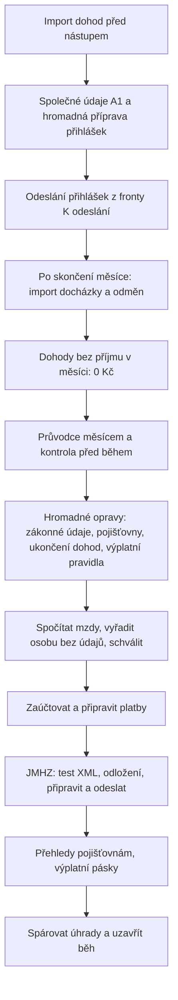

# 122. Mzdy pro stovky zaměstnanců a brigádníků

> Jak v MyÚčtu zpracovat měsíční mzdy pro stovky lidí: personální agentura
> s brigádníky na DPP a DPČ, výrobní nebo obchodní firma se zaměstnanci na
> pracovní poměr i kombinace obojího. Kapitola
> spojuje hromadné nástroje z ostatních kapitol do jednoho postupu, říká, co
> aplikace udělá sama a co zůstává na vás, a uvádí orientační časy a limity.
> Pro mzdové účetní, které zpracovávají velký počet lidí najednou.

Kapitola nic nového nenastavuje. Popisuje pořadí, ve kterém hromadné akce
použít, a odkazuje na podrobné kapitoly. Postup je stejný pro jakoukoli
firmu; liší se jen tím, odkud přicházejí podklady (šablona Vzor MyÚčto,
docházkový systém, docházka vedená v MyÚčtu). Čísla v příkladech jsou
ilustrativní: **agentura s 300 brigádníky na DPP a 20 zaměstnanci na HPP**,
**výrobní firma se 400 zaměstnanci na HPP a docházkovým systémem** nebo
**obchodní síť s 250 prodavači na HPP a sezónními výpomocemi na DPP**.

## 122.1 Kdy to potřebujete

Kapitolu otevřete, když:

- zpracováváte mzdy pro desítky až stovky lidí a nechcete otevírat kartu po
  kartě,
- každý měsíc nastupují noví brigádníci a jiní končí,
- podklady (hodiny, odměny, nové dohody) dostáváte v Excelu nebo
  z docházkového systému,
- jeden člověk s chybějícím údajem vám drží výplatu nebo hlášení za všechny
  ostatní,
- chcete vědět, co z měsíce aplikace udělá sama a kolik to potrvá.

<!-- cols: 26 40 34 -->
| Kdy | Co udělat | Kde v aplikaci |
|---|---|---|
| jednou při zavádění | Nastavit firmu, složky, účty institucí, šablonu importu | [§ 122.3](#1223-krok-za-krokem-jednorazova-priprava-firmy) |
| před nástupem nových lidí | Naimportovat dohody, doplnit údaje A1, připravit přihlášky | [§ 122.4](#1224-krok-za-krokem-novi-lide-a-dohody) |
| po skončení měsíce | Naimportovat docházku a odměny, doplnit nuly u dohod bez práce | [§ 122.5](#1225-krok-za-krokem-mesicni-podklady) |
| po nahrání podkladů | Projít Průvodce měsícem a kontrolu před během, opravit hromadně | [§ 122.6](#1226-krok-za-krokem-pruvodce-mesicem-a-kontrola-pred-behem) |
| na začátku čtvrtletí a při změně | Nastavit průměrný a pravděpodobný výdělek | [§ 122.7](#1227-krok-za-krokem-prumerny-a-pravdepodobny-vydelek) |
| po kontrole | Spočítat a schválit běh, případně vyřadit osobu | [§ 122.8](#1228-krok-za-krokem-vypocet-a-schvaleni) |
| do 20. dne následujícího měsíce | JMHZ, přehledy pojišťovnám, odložení a doplnění | [§ 122.9](#1229-krok-za-krokem-jmhz-a-dalsi-podani) |
| k datu výplaty | Platby a výplatní pásky | [§ 122.10](#12210-krok-za-krokem-platby-a-vyplatni-pasky) |

### 122.1.1 Mapa celého měsíce

Vlevo nahoře jsou kroky, které se dělají průběžně během měsíce (dohody
a přihlášky před nástupem), zbytek se dělá po skončení měsíce v pořadí
[Průvodce měsícem](80_Mzdove_behy.md#802a-pruvodce-mesicem-mezd).

## 122.2 Než začnete

1. **Mzdy jsou nastavené.** Firma prošla prvním nastavením mezd
   ([§ 75.3](75_Uplne_mzdy.md#753-krok-za-krokem-prvni-nastaveni-mezd)):
   zaměstnavatel a účtárny s variabilním symbolem ČSSZ, legislativní pravidla,
   certifikát pro podání a datová schránka.
2. **Licence stačí na počet lidí.** Mzdové pásmo se určuje podle součtu
   aktivních zaměstnanců ([§ 104.10.2](104_Licence_a_aktivace.md#104102-mzdove-pasmo-a-mzdovi-uzivatele)).
   Skončené dohody proto ukončujte ([§ 122.6.3](#12263-hromadne-opravy-z-kontroly)),
   jinak se počítají dál.
3. **Oprávnění.** Import dohod a založení osob chce právo zápisu osob, import
   docházky právo zapisovat mzdové vstupy, hromadná úprava podmínek a ukončení
   dohod právo měnit pracovní vztahy, schválení vstupů a běhu právo schvalovat.
   Celý měsíc může zpracovat jedna účetní, která má všechna tato práva.
4. **Podklady v jednom souboru.** Agentura bez docházkového systému si
   připraví sešit podle šablony **Vzor MyÚčto**
   ([§ 122.3.1](#12231-sablona-importu-vzor-myucto)). Firma s docházkovým
   systémem si jednou nastaví mapování sloupců.

## 122.3 Krok za krokem: jednorázová příprava firmy

Tohle uděláte jednou. Každý krok ušetří práci se stovkami lidí každý měsíc.

1. **Nastavení mezd.** V `Mzdy → Nastavení mezd` vyplňte záložku
   **Zaměstnavatel a účtárny** (výchozí zdravotní pojišťovna, výchozí účtárna,
   variabilní symbol ČSSZ každé účtárny) a v **Politiky a připravenost**
   výplatní termín a doručení výplatnic
   ([§ 90.3](90_Nastaveni_mezd.md#903-krok-za-krokem-zamestnavatel-a-mzdove-uctarny)).
   Má-li firma víc účtáren, zkontrolujte variabilní symbol u každé; účtárna bez
   něj nezastaví hlášení ostatních, ale sama se nepodá.
2. **Účty institucí.** Na záložce **Účty institucí** založte účet ČSSZ,
   finančního úřadu a každé zdravotní pojišťovny, u které jsou vaši lidé
   pojištění
   ([§ 90.5](90_Nastaveni_mezd.md#905-krok-za-krokem-ucty-instituci)). Bez
   účtu instituce nevznikne platba odvodu.
3. **Mzdové složky.** V `Mzdy → Mzdové složky a vstupy` zkontrolujte
   zařazení do JMHZ u složek, které budete importovat: **Hodinová mzda podle
   docházky**, **Odměna** a vlastní složka **Mimořádná odměna** ze Vzoru
   MyÚčto. Mimořádné odměně nastavte cílový atribut jednou za firmu
   ([§ 91.8](91_Mzdove_slozky_a_vstupy.md#918-krok-za-krokem-zarazeni-slozky-do-jmhz)).
   Bez zařazení by hlášení nešlo zmrazit.
4. **Výplatní pravidla hromadně.** Výplatní pravidlo je údaj osoby, ne firmy,
   a potřebujete ho jen tehdy, když platby mezd připravujete v aplikaci.
   V `Mzdy → Zaměstnanci → Další funkce` klikněte na **Výplatní pravidla
   z karet osob**. Osobám s výplatou v hotovosti nebo s jediným ověřeným účtem
   pravidlo doplní, u ostatních napíše proč ne. Nabídne nejvýš 500 osob
   najednou ([§ 86.3](86_Zamestnanci.md#863-krok-za-krokem-novy-zamestnanec)).
   Účet z importu je rovnou ověřený uživatelem, který import spustil.
5. **Společné podmínky vztahů.** Mají-li brigádníci stejnou profesi, pracoviště
   nebo pravděpodobný výdělek, nastavte je najednou v **Další funkce →
   Upravit podmínky vybraných vztahů**
   ([§ 86.6.1](86_Zamestnanci.md#8661-hromadna-uprava-podminek-vybranych-vztahu)).
   Vztahům se mzdou z importu nenastavujte sjednanou hodinovou sazbu; mzdu
   ze sazby a hodin dopočte import docházky.
6. **Šablona importu.** V `Mzdy → Importy` si stáhněte šablonu
   ([§ 122.3.1](#12231-sablona-importu-vzor-myucto)) a domluvte s tím, kdo
   podklady připravuje, které sloupce bude vyplňovat.

**Jak poznáte, že je hotovo:** Kontrola před během za první měsíc nehlásí
nic ze skupiny **Nastavení firmy** a v `Mzdy → Nastavení mezd` je u každé
pojišťovny, ČSSZ a finančního úřadu účinný účet.

### 122.3.1 Šablona importu Vzor MyÚčto

Firma bez docházkového systému vyplňuje jeden sešit. **Vzor MyÚčto** je
vzorový profil mapování, který dostane každá firma a který se s novou verzí
aplikace aktualizuje sám, pokud jste ho neupravili. Aktuální je verze 6,
která obsahuje sloupce pro přihlášku A1 i **Odpracované dny**. Upravený vzor
se sám nepřepíše: v **Mapování sloupců** nese štítek **Nová verze vzoru**
a tlačítko **Aktualizovat vzor** ho nahradí (vlastní úpravy se ztratí, proto
si profil případně duplikujte). Smazaný vzor vrátí **Obnovit vzor MyÚčto**.

Existují dvě šablony se stejnými názvy sloupců:

<!-- cols: 24 38 38 -->
| Šablona | Kde ji stáhnete | Jeden řádek je |
|---|---|---|
| **Docházka** (list **Podklady**) | `Mzdy → Importy`, záložka **Docházka**, **Stáhnout šablonu XLSX** | jedna osoba za měsíc: hodiny, dny, odměny a údaje osoby |
| **Dohody** (list **Dohody**) | `Mzdy → Importy`, záložka **Dohody**, **Stáhnout šablonu XLSX** | jedna dohoda nebo pracovní poměr bez vazby na měsíc |

Obě mají list **Návod** s popisem sloupců, formátů a kódů pojišťoven a dva
ukázkové řádky smyšlených osob, které před importem smažte. Název listu ani
hlavičky neměňte.

Sloupce šablony docházky (úplný popis v
[§ 90.14.11](90_Nastaveni_mezd.md#901411-import-dochazky)):

<!-- cols: 24 76 -->
| Skupina | Sloupce |
|---|---|
| Osoba | Osobní číslo, Příjmení a jméno (povinné), Rodné číslo, Datum narození, Zdravotní pojišťovna (kód), Druh vztahu (HPP, DPP, DPČ), Nástup, Týdenní úvazek, Měsíční mzda, Hodinová sazba (Kč/h), Konec dohody, Číslo účtu |
| Registrace ČSSZ a A1 | Ulice, Číslo domu, Obec, PSČ, Stát, Státní občanství, CZ-ISCO, Druh činnosti, Místo výkonu práce, Daňová rezidence, Prohlášení poplatníka, Prohlášení od, Vzdělání, Postavení v zaměstnání, Rodné příjmení, Místo narození, Stát narození, Režim práce, Nepřetržitý provoz, Obec pracoviště, Název pozice, Vedoucí pozice |
| Hodiny a dny | Odpracováno; Odpracované dny; z toho noc, víkend, svátek, přesčas; Dovolená, Nemoc, Lékař |
| Peníze (Kč za měsíc) | Hodinová mzda celkem, Odměna, Mimořádná odměna, Srážka z čisté mzdy |

Pravidla, na kterých u stovek řádků nejvíc záleží:

- **Rodné číslo vyplňujte vždy a jako text.** Je to nejspolehlivější klíč
  párování. Rodné číslo uložené v Excelu jako číslo ztratí úvodní nulu;
  import ho doplní jen tehdy, když doplněné projde kontrolní číslicí a datem.
- **Osobní číslo jen jedinečné, nebo vůbec.** Číslo, které má ve firmě
  nebo v souboru víc lidí (například „1“ u každého brigádníka), se k párování
  nepoužije.
- **Druh vztahu u DPP vždy vyplňte.** Bez něj dostane nově zakládaná osoba
  pracovní poměr. **Týdenní úvazek** u DPP nevyplňujte.
- **Hodinová sazba** je pravděpodobný výdělek pro náhrady, ne sjednaná
  sazba. Řádek s hodinami a sazbou bez částky dostane mzdu sazba × hodiny.
- **Odpracované dny** vyplňujte každý měsíc. Bez nich aplikace od druhého
  čtvrtletí skutečný průměr nenavrhne
  ([§ 122.7](#1227-krok-za-krokem-prumerny-a-pravdepodobny-vydelek))
  a hlášení JMHZ nemá počet odpracovaných dnů.
- **Místo výkonu práce** jako šestimístný kód obce, název obce jen
  jednoznačný.

### 122.3.2 Jedna DPP na delší období

Doporučujeme s brigádníkem uzavřít **jednu DPP na delší období** (třeba do
31. 12.) místo nové dohody ke každé akci. Do sloupce **Konec dohody** uveďte
konec období.

<!-- cols: 34 33 33 -->
| | Jedna dlouhodobá DPP | Nová DPP ke každé akci |
|---|---|---|
| Přihláška ČSSZ | jednou | ke každé dohodě nová přihláška i odhláška |
| Import docházky | spáruje osobu každý měsíc bez zakládání | každý měsíc zakládá vztah |
| Měsíc bez práce | nulový formulář JMHZ | nic, dohoda netrvá |
| Roční limit 300 hodin | sleduje se přes všechny DPP osoby | stejně |

Měsíc, kdy brigádník na dlouhodobé DPP nepracoval, potřebuje vstup 0 Kč
a podá se za něj nulový formulář JMHZ. Obojí jde hromadně
([§ 122.5.3](#12253-dohody-bez-prijmu-v-mesici)). Import i ruční zakládání
otevřenou DPP poznají a nabídnou ji použít a případně prodloužit
([§ 86.3.1](86_Zamestnanci.md#8631-dalsi-dpp-osoby-ktera-ma-otevrenou-dohodu)).

## 122.4 Krok za krokem: noví lidé a dohody

Přihláška k ČSSZ se podává před nástupem, nejdřív osm dnů předem. Import
docházky po skončení měsíce je na přihlášku pozdě, proto dohody zakládejte
importem dohod hned, jak je máte podepsané.

### 122.4.1 Import dohod

Postup je v [§ 90.11.1](90_Nastaveni_mezd.md#90111-krok-za-krokem-import-dohod-bez-dochazky).
Ve zkratce pro agenturu, která před sezónou uzavírá 120 nových DPP:

1. Otevřete `Mzdy → Importy`, záložku **Dohody**, a klikněte na **Stáhnout
   šablonu XLSX**.
2. Vyplňte **Příjmení**, **Jméno** (nebo **Příjmení a jméno**), **Druh
   vztahu**, **Nástup**, **Rodné číslo** jako text, **Konec dohody**,
   **Zdravotní pojišťovna**, **Číslo účtu**, sazbu nebo měsíční odměnu
   a údaje pro registraci a A1 ([§ 122.4.3](#12243-udaje-pro-prihlasku-a1)).
   Osoba s víc dohodami má víc řádků.
3. Nahrajte soubor a klikněte na **Načíst náhled**. Nahoře je souhrn
   **Nové osoby**, **V evidenci**, **K potvrzení**, **Dohody k založení**,
   **Už existují** a **Chyby**.
4. U osob v sekci **Shoda podle jména a data narození** zvolte **Ano, založit
   jí jen dohody**, nebo **Ne, založit novou osobu**. Dokud nerozhodnete, nejde
   pokračovat.
5. Klikněte na **Založit dohody (N)**. Zakládá se po 50 osobách a tlačítko
   ukazuje průběh **Zakládám… X z Y osob**.
6. Pod výsledkem klikněte na odkaz **Mzdová podání → Přihlášky k podání
   (A1)** a pokračujte [§ 122.4.4](#12244-hromadna-priprava-prihlasek-a1).

**Co je automatizované:** osoba z evidence dostane jen nový pracovní vztah
(nová karta ani druhé rodné číslo nevznikne), nová osoba kartu i vztah,
výplatní účet se uloží jako ověřený, údaje pro registraci se nové osobě
zapíší celé a existující jen ty, které chybí. Dohoda s nástupem dnes nebo
dřív je aktivní, budoucí zůstane plánovaná.

**Idempotence.** Dohodu, kterou osoba už má (stejný druh vztahu platný ke dni
nástupu z řádku), import nezaloží znovu. Opravený soubor proto můžete nahrát
celý znovu a založí se jen to, co dřív skončilo chybou. Řádek, který v souboru
opakuje dřívější dohodu téže osoby, má stav **Opakovaný řádek**.

**Jak poznáte, že je hotovo:** Náhled načtený znovu ukazuje u všech dohod
**Už existuje** a souhrn **Chyby** je nula.

### 122.4.2 Jak import pozná osobu

Import dohod i import docházky párují osobu stejně. Pořadí je pevné:

1. **Rodné číslo** z podkladů má přednost před vším ostatním. Páruje se přes
   otisk, rodná čísla v evidenci zůstávají šifrovaná. Najde-li rodné číslo
   osobu v evidenci, rozhodne; na osobní číslo ani jméno se už nepadá.
2. **Uložená vazba** z dřívějšího importu (podle osobního čísla nebo jména).
3. **Osobní číslo** shodné s kódem vztahu, jen je-li jedinečné. Sdílené
   osobní číslo se nepoužije a vazba podle něj se neuloží; řádek na to
   upozorní a volba **Převzít osobní čísla z podkladů** ho vynechá.
4. **Jméno** mezi osobami se vztahem v daném měsíci. Pořadí jména, diakritika,
   tituly ani poznámka „(DPP)“ nevadí.

Stavy, které uvidíte v kroku **Osoby** importu docházky:

<!-- cols: 22 40 38 -->
| Stav | Co znamená | Co udělat |
|---|---|---|
| **Spárováno** / **Propojeno** | Osoba má vztah platný v měsíci, podle rodného čísla, osobního čísla, jména, nebo uložené vazby | Nic |
| **Nejasné** | Víc kandidátů | Vyberte vztah ručně ve sloupci **Přiřadit k existujícímu vztahu** |
| **Nenalezeno** | Osoba v měsíci vztah nemá. Je-li v evidenci (skončená dohoda), náhled napíše, že se jí založí jen nový vztah | Zaškrtněte **Založit nového**, nebo nechte na volbě **Chybějící osoby založit automaticky** |
| **Rozpor** | Rodné číslo ukazuje na jinou osobu než osobní číslo, vazba nebo kód vztahu | Opravte podklady, nebo vztah vyberte ručně; řádek se sám nespáruje ani nezaloží |

**Shoda jménem a datem narození.** Bez rodného čísla v podkladech nabídne
import osobu z evidence se stejným jménem a datem narození jen jako návrh.
V kroku **Osoby** zvolte **Je to tatáž osoba: založit jí jen nový pracovní
vztah**, nebo **Jiná osoba: založit novou kartu**. Bez volby se osoba
nezaloží a automatické založení ji vynechá.

**Rodné číslo z Excelu jako číslo.** Číslo bez lomítka se 7 až 9 číslicemi se
doplní nulami na 10, jen když projde kontrolní číslicí a datem. Devítimístné
rodné číslo platí jen pro narozené před rokem 1954. Je-li v podkladech
**Datum narození**, rozhodne mezi oběma čteními a rodné číslo, které mu
odporuje, se nepoužije. Chybné rodné číslo nové osoby je červená chyba řádku
a osoba se k založení nenabídne.

Podrobná pravidla jsou v odstavci **Rodné číslo a osobní číslo**
v [§ 90.14.11](90_Nastaveni_mezd.md#901411-import-dochazky).

### 122.4.3 Údaje pro přihlášku A1

Plná přihláška (REGZEC A1) potřebuje ověřený profil A1 každého vztahu. U stovek
lidí ho nevyplňujte po kartách. Máte dvě cesty a můžete je kombinovat:

**Importem.** Vyplněné sloupce šablony (adresa s **Číslem domu** zvlášť,
**Rodné příjmení**, **Místo narození**, **Stát narození**, **Státní
občanství**, **CZ-ISCO**, **Místo výkonu práce**, **Režim práce**,
**Nepřetržitý provoz**, **Název pozice**, **Vedoucí pozice**, případně
**Obec pracoviště**) dají nové osobě po založení ověřený profil A1. Číslo domu
„12/3“ se rozdělí na číslo popisné a orientační. Nečitelná hodnota osobu
nezastaví, u osoby se objeví upozornění s názvem sloupce a hodnota se
nezapíše.

**Hromadně pro všechny neúplné profily.** Režim práce, nepřetržitý provoz,
pozici, obec pracoviště a vedoucí pozici má firma obvykle u všech brigádníků
stejné:

1. Otevřete `Mzdy → Podání a hlášení → Mimořádná podání ▾ → Přihlášky
   k podání (A1)` a nastavte **Období od** a **Období do**.
2. Klikněte na **Nastavit společné údaje A1**. Dialog uvede, kolik vztahů
   v období má neúplný profil.
3. Vyplňte společné hodnoty. Vyplněné údaje se nepřepisují, pokud
   nezaškrtnete **Přepsat i údaje, které už v profilu vyplněné jsou**. Volba
   **Číslo domu oddělit z ulice** rozdělí „Dlouhá 12/3“ na ulici, číslo
   popisné a orientační.
4. Uložte. Co zůstane neúplné, ukáže seznam u řádku vztahu.

Akce bere všechny neúplné profily zvoleného období, ne zaškrtnuté řádky,
a najednou zpracuje nejvýš 200 vztahů. Za vztah s odeslanou registrací se
nic nemění. Podrobnosti jsou v
[§ 85.5](85_Podani_a_hlaseni.md#855-krok-za-krokem-nastup-zamestnance).

### 122.4.4 Hromadná příprava přihlášek A1

1. V **Přihlášky k podání (A1)** zkontrolujte období. Odkaz z Průvodce
   měsícem i z výsledku importu dohod nese zvolený měsíc v adrese.
2. Seznam ukáže u každého vztahu stav profilu (**Úplný**, **Neúplný**
   s výčtem chybějících údajů, **Chybí**), lhůtu přihlášky a varování, má-li
   osoba jinou otevřenou DPP s ID PPV (vztah je nejspíš založený dvakrát).
3. Zaškrtněte vztahy s úplným profilem a klikněte na **Připravit vybrané**.
   Najednou jde připravit nejvýš 200 vztahů, větší počet připravte
   na několikrát. Opakované stisknutí druhou přihlášku nezaloží.
4. Připravené přihlášky odešlete v záložce **K odeslání**.

Přihlášku jde připravit nejdřív osm dnů před nástupem; dřívější pokus
aplikace odmítne s datem, od kdy to půjde. Podrobně v
[§ 85.14.16](85_Podani_a_hlaseni.md#851416-registrace-zamestnance-prezec-a-regzec).

**Jak poznáte, že je hotovo:** Vztahy zmizely ze seznamu přihlášek, po
načtení protokolu mají OIČ a ID PPV a v Průvodci měsícem je krok
**Registrace ČSSZ a oznámení ZP** hotový.

Oznámení zdravotním pojišťovnám (HOZ) se připravuje hromadně za pojišťovnu na
záložce **Zdravotní pojišťovny**; u DPP a DPČ je lhůta do 20. dne
následujícího měsíce ([§ 85.5](85_Podani_a_hlaseni.md#855-krok-za-krokem-nastup-zamestnance)).

### 122.4.5 Registrace podané mimo aplikaci

Přihlásili-li jste dohody na ePortálu ČSSZ nebo v jiném programu, aplikace
o tom neví a každý měsíc je bude připomínat. Označte je hromadně:

1. Otevřete `Mzdy → Přehled mezd`, panel **Zákonné termíny** (z Průvodce
   měsícem vede odkaz **Podáno mimo aplikaci (N)**).
2. Rozbalte skupinu **Registrace ČSSZ / JMHZ**.
3. Zaškrtněte osoby (výběr platí napříč stránkami), nebo použijte **Označit
   celou skupinu jako splněnou**.
4. Vyplňte poznámku, čím je podání doložené (předvyplněno „Vyřízeno
   v předchozím zpracování mezd“), a potvrďte.

Velká skupina se zpracuje po dávkách, průběh je vidět. Opakované spuštění nic
nepokazí. Postup je v
[§ 85.14.3](85_Podani_a_hlaseni.md#85143-zakonne-terminy-na-prehledu-mezd)
a [§ 85.12](85_Podani_a_hlaseni.md#8512-krok-za-krokem-podano-mimo-aplikaci).

### 122.4.6 Proč registrovat každou DPP a DPČ

Do evidence zaměstnanců u ČSSZ se přihlašuje **každá DPP a DPČ**, i když
v ní nevzniká účast na pojištění (dohoda pod rozhodným příjmem). Za každý
měsíc, kdy přihlášená dohoda trvá a příjem nebyl, se podává nulový formulář
JMHZ ([§ 85.14.16](85_Podani_a_hlaseni.md#851416-registrace-zamestnance-prezec-a-regzec)).

<!-- cols: 40 60 -->
| Vztah bez registrace | Co udělá mzdový běh |
|---|---|
| DPP nebo DPČ **bez účasti** na pojištění | varování; běh se spočítá i schválí a varování jde skrýt |
| DPP, DPČ nebo HPP **s účastí** na pojištění | varování s povinnou výjimkou: schválit nepůjde, dokud registraci nepodáte nebo neschválíte výjimku |

Varování mzdu nezastaví, povinnost přihlásit dohodu ale trvá. Kontrola tu
jen připomíná, nerozhoduje za vás.

Podanou registraci v aplikaci běh pozná sám. Registraci podanou jinde
označte podle [§ 122.4.5](#12245-registrace-podane-mimo-aplikaci).

## 122.5 Krok za krokem: měsíční podklady

### 122.5.1 Import docházky

Postup je v [§ 90.11](90_Nastaveni_mezd.md#9011-krok-za-krokem-mesicni-import-dochazky).
Pro 300 brigádníků ze šablony Vzor MyÚčto:

1. Otevřete `Mzdy → Importy`, záložku **Docházka**, zvolte měsíc a nahrajte
   sešit. Profil mapování se vybere sám; pod výběrem vidíte, kolik sloupců
   rozpoznal.
2. Klikněte na **Načíst náhled**. Import upozorní, když název souboru nebo
   listu ukazuje na jiný měsíc nebo když období už má vstupy z jiného
   importu; takový nález je nutné výslovně potvrdit.
3. V kroku **Osoby** nastavte filtr **Vyžaduje pozornost** a vyřešte stavy
   **Nejasné**, **Rozpor** a návrhy podle jména a data narození
   ([§ 122.4.2](#12242-jak-import-pozna-osobu)). U osoby s otevřenou DPP
   nechte výchozí **Použít otevřenou dohodu**.
4. V kroku **Souhrn a použití** zkontrolujte součty a volby podle tabulky
   pod postupem.
5. Klikněte na **Použít (N osob)**. Nejdřív se založí chybějící osoby
   (**Zakládám osoby…**), pak se zapíše docházka (**Importuji…**).
6. Návrhy mzdových vstupů schvalte v `Mzdy → Mzdové složky a vstupy`
   tlačítkem **Schválit N odpovídajících filtru**
   ([§ 91.5](91_Mzdove_slozky_a_vstupy.md#915-krok-za-krokem-hromadne-schvaleni-vstupu)),
   nebo později přímo z běhu tlačítkem **Schválit vše**.

Volby v kroku **Souhrn a použití**:

<!-- cols: 40 60 -->
| Volba | Kdy ji nechat zapnutou |
|---|---|
| **Chybějící osoby založit automaticky (N)** | Vždy, když soubor nese rodná nebo osobní čísla. Osoby bez čísel import sám nezaloží. |
| **Zapsat souhrn docházky do pracovních měsíců** | Vždy, když podklady nesou hodiny nebo dny (je výchozí). Bez ní chybí hodiny a dny pro průměr i pro JMHZ. |
| **Bezchybné měsíce rovnou schválit** | Když nechcete pracovní měsíce schvalovat zvlášť. Schválí se jen měsíce bez výjimky, ostatní se vypíšou s důvodem. |
| **Vytvořit mzdové vstupy (návrhy ke schválení)** | Vždy, když soubor nese částky nebo sazbu a hodiny. |
| **Doplnit pravděpodobný výdělek z podkladů (N vztahů)** | U nových lidí bez průměru. |
| **Doplnit chybějící údaje pro registraci ČSSZ (N osob)** | Když soubor nese adresy a údaje A1; přepisuje jen prázdné. |
| **Zaokrouhlit částky s haléři nahoru na celé koruny (N)** | Vždy, když se nabídne ([§ 122.5.4](#12254-zaokrouhleni-na-koruny)). |
| **Uložit vazby osob na pracovní vztahy** | Vždy; příští měsíc se osoby spárují samy. |
| **Založit srážky ze mzdy (N)** | Když soubor nese srážky a máte uzavřené dohody o srážkách. |

**Co import udělá sám:** spáruje osoby, založí nové osoby a vztahy, zapíše
souhrn hodin a odpracovaných dnů do pracovních měsíců, dopočte mzdu sazba ×
hodiny, založí návrhy vstupů (hodinová mzda, odměna, mimořádná odměna),
doplní pravděpodobný výdělek, údaje pro registraci a dohody o srážkách.
Opakované použití týchž souborů nic nezdvojí (**Tytéž soubory už byly za
toto období použity**). U DPP sečte hodiny za kalendářní rok včetně jiných
DPP osoby a od 240 h upozorní na blížící se limit 300 h.

**Co zůstává na vás:** kontrola náhledu, vyřešení nejasných osob a rozporů,
schválení vstupů a mzdového běhu.

Firma se 400 zaměstnanci na HPP a docházkovým systémem postupuje stejně,
jen jednou nastaví mapování sloupců svého exportu (**Upravit mapování**).
Vede-li docházku přímo v MyÚčtu, schválí měsíc všem v `Mzdy → Docházka
a směny` tlačítkem **Schválit měsíc všem**
([kapitola 77](77_Dochazka_a_smeny.md)) a pravidelné měsíční mzdy vytvoří
v Rychlém měsíčním vstupu tlačítkem **Vytvořit a schválit vstupy
z pravidelných složek (N)**.

**Jak poznáte, že je hotovo:** V historii importů je dávka za měsíc,
v Průvodci měsícem krok **Podklady měsíce** ukazuje **Importy docházky za
měsíc: 1 (osob: N)** a nehlásí neschválené vstupy.

### 122.5.2 Rychlý měsíční vstup

`Mzdy → Rychlý měsíční vstup` je tabulka všech vztahů za měsíc
([§ 79.3](79_Rychly_mesicni_vstup.md#793-krok-za-krokem-mesicni-mzdy-a-odmeny)).
U stovek lidí ji použijte na úpravy, které import nenese: jednotlivé odměny,
opravu částky z importu, nulu u jednoho člověka. Hledání nad tabulkou bere
jméno i osobní číslo. **Uložit a schválit vše (N)** uloží rozepsané změny ze
všech stránek najednou. Prázdné pole neznamená nulu.

### 122.5.3 Dohody bez příjmu v měsíci

Dohoda, která v měsíci trvá, ale brigádník nepracoval, potřebuje výslovně
zadaný vstup **0 Kč** u základní odměny. Bez něj běh ohlásí chybějící mzdovou
složku, aby zapomenutá mzda neprošla. Za takovou dohodu se podá nulový
formulář JMHZ.

1. V `Mzdy → Rychlý měsíční vstup` zvolte měsíc a klikněte na **Dohody bez
   příjmu v měsíci**.
2. Aplikace vypíše DPP a DPČ bez vstupů, odpracované doby, složek
   a příplatků za měsíc, ze všech stránek, všechny předvybrané.
3. Odškrtněte dohody, u kterých příjem přijde (například odměna, kterou
   teprve zadáte).
4. Klikněte na **Uložit a schválit 0 Kč (N)**. Bez práva schvalovat vzniknou
   koncepty.

Pracovní poměry nabídka nezahrnuje: u HPP bez příjmu jde o jinou situaci
(neplacené volno, nemoc), kterou zadejte v nepřítomnostech.

### 122.5.4 Zaokrouhlení na koruny

Měsíční hlášení vykazuje výdělek v celých korunách a mzda se zaokrouhluje
nahoru, ve prospěch zaměstnance. Vstup s haléři u složky zařazené do hlášení
mzdový běh zablokuje. Máte dvě místa, kde to vyřešit najednou:

- při importu volba **Zaokrouhlit částky s haléři nahoru na celé koruny (N)**,
  vstupy pak vzniknou rovnou zaokrouhlené,
- dodatečně v `Mzdy → Mzdové složky a vstupy` tlačítkem **Zaokrouhlit vstupy
  na celé koruny nahoru** za celé období
  ([§ 91.12.3](91_Mzdove_slozky_a_vstupy.md#91123-koncept-schvaleni-a-filtry)).

Osvobozené benefity na zákonném limitu (stravování) se nezaokrouhlují.
Vstupy uzamčené během uvolní až zrušení běhu nebo obnova podkladů.

## 122.6 Krok za krokem: Průvodce měsícem a kontrola před během

### 122.6.1 Sedm kroků průvodce

`Mzdy → Průvodce měsícem` (odkaz **Průvodce měsícem** je i v hlavičce
Mzdových běhů) ukáže celý měsíc na jedné obrazovce. Nahoře zvolte **Období**,
pod ním je sedm kroků se stavem, počtem a jedním hlavním tlačítkem. Průvodce
nic nepočítá ani neukládá, jen posílá na místo práce
([§ 80.2a](80_Mzdove_behy.md#802a-pruvodce-mesicem-mezd)).

<!-- cols: 26 40 34 -->
| Krok | Co sledovat u stovek lidí | Hlavní tlačítko |
|---|---|---|
| 1. Podklady měsíce | Počet importů a osob v nich, neschválené vstupy, lidé bez mzdy, nerozhodnuté nepřítomnosti | **Importovat docházku**, **Otevřít měsíční vstupy** |
| 2. Noví lidé a dohody | Chybějící pojišťovna, prohlášení, způsob výplaty, příslušnost, dohody po sjednaném konci | **Doplnit chybějící údaje** |
| 3. Registrace ČSSZ a oznámení ZP | Přihlášky A1 za měsíc (připravit lze, neúplné, zatím brzy, po termínu), otevřená HOZ | **Připravit přihlášky hromadně** |
| 4. Kontrola před během | **Zastaví: N · stojí opravnou revizi: N · doplní se kdykoli: N** | **Otevřít kontroly v Mzdových bězích** |
| 5. Výpočet a schválení | Stav běhu, počet kontrol, které brání schválení | **Založit a spočítat běh**, **Otevřít mzdový běh** |
| 6. JMHZ a další měsíční podání | **Splněno X z Y**, z toho JMHZ | **Otevřít měsíční přehled podání** |
| 7. Platby a výplatní pásky | **Doložené úhrady: X z Y**, počet dokumentů | **Otevřít platby mezd** |

Krok, na který je řada, je označený **Teď na řadě**. Nahoře je průběh
**Hotovo X z 7 kroků**; po dokončení všeho **Měsíc je kompletní**.
Tlačítko **Obnovit stav** načte počty znovu po práci v jiném okně.

### 122.6.2 Jak číst kontrolu před během

**Kontrola před zahájením** se ukáže v `Mzdy → Mzdové běhy` ještě před
zamknutím vstupů. U stovek lidí jsou nálezy **souhrnné**: jeden řádek za druh
problému s počtem osob, ne jeden řádek za osobu. Každý nález má vyznačený
dopad:

<!-- cols: 34 66 -->
| Dopad | Co znamená |
|---|---|
| **Bez tohohle se nedá počítat** | Výpočet nemá z čeho vyjít. Vyřešte jako první. |
| **Spočítat půjde, schválit ne** | Červené. Běh se spočítá, ale schválit nepůjde, dokud nález nevyřešíte nebo neschválíte výjimku (například chybějící registrace u vztahu s účastí na pojištění). |
| **Pozdější oprava znamená opravnou revizi** | Údaj vstupuje do zmrazeného snímku. Doplňte ho teď, potom už jen novou revizí (například pracoviště pro JMHZ, chybějící docházka). |
| **Doplní se kdykoli, běh to nezdrží** | Na výpočet nemá vliv, doplňte před podáním. |

Druhé označení říká, kam údaj patří: **Nastavení firmy** (jednou), **Měsíční
práce**, nebo **Údaj na kartě osoby** (jednou za osobu). Nález má
v kontrole před zahájením stejnou závažnost jako po výpočtu.

**Počty a výpis „N z M“.** Týká-li se nález víc osob, než se vejde do
přehledu, vypíše se jen část a tlačítko **Zobrazit vypsaných N z M** ji
rozbalí. Celou skupinu otevře odkaz **Zobrazit všech N osob v seznamu
zaměstnanců** (seznam zúžený na dotčené osoby) nebo **Otevřít agendu pro
všechny dotčené (N)**. Počet ve skupině může být o osobu vyšší než počet
v hromadném dialogu, protože skupina zahrnuje i osobu s jiným nálezem téhož
druhu.

Po opravách klikněte na **Zkontrolovat znovu**. **Přesto zahájit** spustí
výpočet i s nálezy; zahájení zamkne vstupy a co zapíšete potom, se do výpočtu
dostane až obnovením podkladů.

Varování, které popisuje stav ve firmě v pořádku a opakovalo by se každý
měsíc (osoby bez podepsaného prohlášení, dohody bez registrace bez účasti na
pojištění), skryjete tlačítkem **Skrýt pro všech N osob**
([§ 80.8](80_Mzdove_behy.md#808-krok-za-krokem-skryti-opakujiciho-se-varovani)).

### 122.6.3 Hromadné opravy z kontroly

Tlačítka u nálezů otevřou hromadný dialog zúžený na dotčené osoby a se
správným měsícem. Po **Zavřít** se vrátíte do kontroly nebo průvodce, odkud
jste přišli. Tytéž akce jsou v `Mzdy → Zaměstnanci → Další funkce`, tam se
měsíc předvyplní podle nejstaršího neschváleného běhu.

<!-- cols: 30 40 30 -->
| Tlačítko u nálezu | Co udělá | Podrobně |
|---|---|---|
| **Doplnit výchozí zákonné údaje od MM/RRRR (N)** | Doplní českou daňovou rezidenci, českou příslušnost k pojištění a neuplatňování slevy důchodce. Existující údaj nemění. Cizincům bez adresy v cizině a bez A1 jen po zaškrtnutí potvrzení. Volitelně zapíše chybějící prohlášení jako nepodepsané. | [§ 80.7](80_Mzdove_behy.md#807-krok-za-krokem-doplneni-zakonnych-udaju-po-importu), [§ 80.11.9](80_Mzdove_behy.md#80119-hromadne-doplneni-vychozi-zakonne-evidence) |
| **Zdravotní pojišťovny hromadně (N)** | Vybere pojišťovnu a měsíc platnosti každé osobě; **Doplnit prázdné** vyplní stejnou všem bez pojišťovny | [§ 80.7](80_Mzdove_behy.md#807-krok-za-krokem-doplneni-zakonnych-udaju-po-importu) |
| **Podepsaná prohlášení hromadně** | Zapíše podpis prohlášení poplatníka s prvním měsícem slevy podle § 38k ZDP | [§ 86.4.1](86_Zamestnanci.md#8641-podepsana-prohlaseni-hromadne) |
| **Ukončit skončené dohody (N)** | Ukončí vztahy po sjednaném konci, nabídne i dohody bez aktivity a archivaci; nejvýš 500 vztahů najednou | [§ 86.9.1](86_Zamestnanci.md#8691-hromadne-ukonceni-skoncenych-dohod) |
| **Doplnit místo výkonu práce (N)** | Doplní pracoviště z číselníku ČSSZ vztahům, které ho nemají | [§ 80.7](80_Mzdove_behy.md#807-krok-za-krokem-doplneni-zakonnych-udaju-po-importu) |
| **Doplnit výplatní pravidla z karet osob (N)** | Doplní pravidlo osobám s hotovostí nebo jediným ověřeným účtem | [§ 80.3](80_Mzdove_behy.md#803-krok-za-krokem-spocitat-a-schvalit-mzdy) |
| **Doplnit pravděpodobný výdělek ze sazby** | Založí a schválí pravděpodobný výdělek ze sjednané sazby vztahům, kterým chybí průměr | [§ 76.11.1](76_Absence_a_dovolena.md#76111-prumerny-a-pravdepodobny-vydelek) |
| **Nastavit „nepožádal“ osobám bez prohlášení (N)** | Zapíše, že o roční zúčtování nepožádali lidé, kteří prohlášení nepodepsali | [§ 84.5](84_Rocni_zuctovani.md#845-krok-za-krokem-zuctovani-vsem-zadatelum-najednou) |

Co výpočet sám nevyžaduje: chybějící záznam o prohlášení se počítá jako
nepodepsané (bez slev, u dohody pod rozhodnou částkou srážková daň),
rezidence u nepodepsaného prohlášení výpočet nezastaví a dohoda bez práce nebo
pod rozhodným příjmem se spočítá i bez pojišťovny, protože účast nevzniká
([§ 80.11.13](80_Mzdove_behy.md#801113-zakonne-vychozi-stavy-ve-vypoctu)).
Souhrnná varování jsou připomínkou před podáním, ne blokací.

**Skončené dohody ukončuje i noc.** DPP a DPČ, jejichž sjednaný konec
uplynul, aplikace ukončí každou noc sama, pokud po konci nemají vstup,
docházku ani zúčtovanou mzdu. Ty ostatní zůstanou ve skupině **Uplynul
sjednaný konec** označené **Vyžaduje kontrolu**. Odhlášku A2 a HOZ je potřeba
vyřídit i u hromadně ukončených vztahů.

## 122.7 Krok za krokem: průměrný a pravděpodobný výdělek

Náhrady (dovolená, překážky) a měsíční hlášení JMHZ potřebují schválený
průměrný nebo pravděpodobný výdělek za čtvrtletí. Brigádník s méně než 21
odpracovanými dny v rozhodném období má pravděpodobný výdělek.

**Hromadně za čtvrtletí** ([§ 76.4](76_Absence_a_dovolena.md#764-krok-za-krokem-prumerny-vydelek-pro-nahrady)):

1. Otevřete `Mzdy → Absence a dovolená`, záložku **Průměrný výdělek**, bez
   vybraného zaměstnance.
2. V části **Hromadné vypočtení průměrů za čtvrtletí** zvolte **Rok
   použití** a **Čtvrtletí**.
3. Klikněte na **Vybrat připravené na stránce** a **Založit a schválit
   vybrané**. Opakujte na dalších stránkách.

**Stejný pravděpodobný výdělek vybraným** (agentura, kde má většina
brigádníků stejnou sazbu):

1. V části **Nastavit pravděpodobný výdělek vybraným** použijte **Rychlý
   výběr**: **Dohody o provedení práce**, nebo **Průměr z minimální mzdy**.
2. Vyplňte **Hodinový výdělek (Kč)**, například 165, a **Odůvodnění**, z čeho
   částka vychází (§ 355 odst. 2 zákoníku práce).
3. Klikněte na **Nastavit vybraným**.

**Spodní mez.** Je-li průměr nižší než minimální mzda, použije se minimální
mzda (§ 357 odst. 1 zákoníku práce). Návrh pod minimální mzdou aplikace
označí, protože tak nízký výdělek bývá chybou v podkladech (hodinová sazba
zapsaná do pole měsíční mzdy). Sjednanou měsíční mzdu, ze které vychází méně
než minimální mzda za hodinu, jako pravděpodobný výdělek nenabídne.

**Od druhého čtvrtletí z odpracovaných dnů.** Skutečný průměr se počítá ze
mzdy a odpracované doby v rozhodném čtvrtletí a o tom, zda osoba odpracovala
aspoň 21 dnů, rozhodují odpracované dny. Import je zapíše ze sloupce
**Odpracované dny** do souhrnu pracovního měsíce. S tímto sloupcem v každém
měsíci vám hromadné vypočtení od druhého čtvrtletí navrhne skutečný průměr
bez ručního zadávání. Bez něj se z importovaných měsíců skutečný průměr
nenavrhne a dny je nutné zadat ručně.

**Změna průměru po schválení běhu.** Nastavíte-li výdělek čtvrtletí, za které
už je schválený běh, karta běhu ukáže **Průměr pro náhrady se změnil po
schválení** s osobami, původním a novým průměrem a náhradami z původního
průměru ([§ 80.5](80_Mzdove_behy.md#805-krok-za-krokem-oprava-schvaleneho-mesice)):

1. Klikněte na **Otevřít opravu a obnovit podklady**. Aplikace vyžádá opravu
   s předvyplněným důvodem, otevře ji a běh přepočítá.
2. Klikněte na **Přepočítat náhrady z nového průměru**. Náhled ukáže osobu,
   náhradu, starou a novou částku. Dovolená zadaná s daty a náhrady z importu
   hodin se přepočítají, překážky s dorovnáním a nemoc se vypíšou k ruční
   úpravě.
3. Potvrďte, běh spočítejte a schvalte. Bylo-li odeslané JMHZ, podejte
   opravné hlášení.

Totéž tlačítko je v záložce **Průměrný výdělek** u schváleného průměru
i v hromadném přehledu za čtvrtletí. Opakované spuštění nic nezmění.

## 122.8 Krok za krokem: výpočet a schválení

Postup je v [§ 80.3](80_Mzdove_behy.md#803-krok-za-krokem-spocitat-a-schvalit-mzdy).
U stovek lidí:

1. V `Mzdy → Mzdové běhy` vyplňte **Mzdové období** a **Datum výplaty**
   a klikněte na **Nový mzdový běh** a **Spočítat mzdy**.
2. Neschválené vstupy schvalte u blokace tlačítkem **Schválit vše** (najednou
   až 500 vstupů, už schválené se přeskočí).
3. Klikněte na **Zobrazit rozpad podle zaměstnanců**. V tabulce **Zaměstnanci
   v běhu** zapněte **Jen s nálezem**, hledejte podle jména nebo osobního
   čísla a řaďte podle sloupců.
4. Varování, která nejde odstranit, převezměte tlačítkem **Schválit výjimku**
   s odůvodněním celou větou.
5. Klikněte na **Schválit**.

**Vyřadit osobu z běhu.** Jedna osoba v ruční kontrole (chybí pojišťovna,
podmínky nebo hodnoty pro srážky) by zastavila schválení všech ostatních.
U její blokace klikněte na **Vyřadit osobu z běhu**, nebo v tabulce
**Zaměstnanci v běhu** na **Vyřadit z běhu**, napište důvod (aspoň 10 znaků)
a potvrďte. Běh dostane novou revizi bez ní a hned se přepočítá. Ostatním
mzdy schvalte. Omyl vrátíte tlačítkem **Vrátit do běhu**, dokud revize není
schválená. Až údaje doplníte, **Vyžádat opravu** a **Otevřít opravu**:
opravná revize osobu zase obsahuje a dostane mzdu za stejné období. Z JMHZ se
vyřazená osoba odloží sama
([§ 80.6a](80_Mzdove_behy.md#806a-krok-za-krokem-vyrazeni-osoby-kterou-nejde-spocitat)).

**Změnit datum výplaty.** Datum výplaty jde změnit až do schválení, i u
zrušeného běhu, tlačítkem **Změnit datum výplaty**. Běh se snímkem dostane
novou revizi a přepočítá se, protože na datu závisí výpočet i lhůty
([§ 80.6b](80_Mzdove_behy.md#806b-krok-za-krokem-zmena-data-vyplaty)). Hláška
„Mzdový běh č. N za toto období už existuje s datem výplaty…“ vede právě sem.

**Oprava schváleného měsíce.** **Vyžádat opravu** převede běh do stavu
**Čeká na opravu**, **Otevřít opravu** založí novou revizi. Vyžádali-li jste
opravu omylem, **Vzít žádost o opravu zpět** vrátí běh do předchozího stavu
a schválená revize, zaúčtování, platby ani podání se nezmění
([§ 80.5](80_Mzdove_behy.md#805-krok-za-krokem-oprava-schvaleneho-mesice)).

**Výjimky se přebírají.** Při obnově podkladů, opravě i novém startu se
schválená výjimka převezme, když sedí kód, osoba i text nálezu. Původní důvod
a autor zůstanou, v historii běhu je **Výjimky převzaté z revize N**. Po
obnově tedy znovu schvalujete jen nové nebo změněné nálezy.

**Vztahy, které z běhu vypadly.** Nastoupil-li brigádník nakonec ne, nebo
jste dohodu ukončili, **Obnovit podklady** odemkne vstupy vztahů, které nová
revize nezná; zrušíte je nebo přesunete. Vstup zadaný na jinou dohodu téže
osoby kontrola jmenuje s vztahem, na který vstup patří.

**Souběh.** Výpočet stovek osob trvá jednotky sekund. Spustí-li jiný uživatel
mezitím výjimku nebo obnovu podkladů, druhý požadavek dostane hlášku **Nad
tímto mzdovým během právě probíhá jiný požadavek**. Počkejte a akci
zopakujte, obrazovka data načte znovu. Mzdové běhy se samy obnoví i po změně
v jiném okně.

**Jak poznáte, že je hotovo:** Běh má stav **Schváleno**, případní vyřazení
jsou v rámečku **Bez mzdy v tomto běhu** s důvodem a v Průvodci měsícem je
krok **Výpočet a schválení** hotový.

## 122.9 Krok za krokem: JMHZ a další podání

Měsíční hlášení se připravuje za celý měsíc ze schváleného běhu
([§ 85.3](85_Podani_a_hlaseni.md#853-krok-za-krokem-mesicni-hlaseni-jmhz)).

1. V `Mzdy → Podání a hlášení` zvolte **Věcné období** a na záložce **JMHZ**
   rozbalte **Podrobnosti**. Potvrďte **Právní skutečnosti JMHZ**.
2. V panelu **Test měsíčního hlášení JMHZ** klikněte na **Otestovat XML**.
   Nic se neodesílá. Test jde spustit i před koncem měsíce.
3. Nálezy u jednotlivých lidí (chybí adresa, pracoviště, jméno) neřešte tak,
   že budete čekat na všechny. Klikněte na **Odložit všechny dotčené (N)**,
   zadejte jeden důvod a test spusťte znovu
   ([§ 85.14.10](85_Podani_a_hlaseni.md#851410-odlozeni-vztahu-z-radneho-hlaseni)).
4. Na záložce **Měsíc** klikněte u JMHZ na **Připravit a odeslat**, nebo
   **Připravit a odeslat vše** pro všechna podání měsíce najednou.
5. Až ČSSZ řádné hlášení přijme a odloženým lidem doplníte údaje (případně
   přes opravu běhu), klikněte v seznamu **Odložené vztahy** na **Doplnit
   všechny odložené jedním opravným hlášením (N)**. Vznikne jedno opravné
   hlášení za každou registraci; komu data dál chybí, zůstane odložený.

Odložení je nesplněná povinnost: formulář musí ČSSZ dostat ve stejné lhůtě.
Pojistná část a sleva se uplatní za všechny včetně odložených.

**Oprava běhu před podáním.** Opravíte-li běh dřív, než hlášení zmrazíte,
seznam **Odložené vztahy** nabídne **Převzít trvající odložení do aktuální
revize (N)**. Převezmou se jen vztahy, které nález pořád mají.

**48 hodin po změně údajů (A3).** Je-li v hlášení vztah s přijatou změnou
údajů mladší než 48 hodin, příprava se zastaví s varováním. ČSSZ takové
hlášení může zamítnout. Zvolte **Připravit a odeslat i tak**, nebo dotčené
vztahy odložte a doplňte opravným hlášením po 48 hodinách.

**Více účtáren.** Má-li běh víc mzdových účtáren a jedné chybí variabilní
symbol ČSSZ, hlášení za ostatní se připraví a přehled vypíše, za kterou ne.
Po doplnění symbolu ji připravte v záložce **JMHZ**.

**Opravné hlášení z aktuální revize.** Po opravě běhu za přijatý měsíc
otevřete na záložce **Odesláno** **Opravit hodnoty hlášení**. Není-li úplná
aktuální příprava, klikněte na **Připravit z aktuální revize**
([§ 85.9](85_Podani_a_hlaseni.md#859-krok-za-krokem-oprava-nebo-storno-odeslaneho-hlaseni-jmhz)).
Zastaralé neodeslané podání se při schválení opravy zruší samo. Měsíc podaný
předchozím programem nejdřív navažte v oddílu **Oprava měsíce podaného
předchozím programem**
([§ 85.14.13](85_Podani_a_hlaseni.md#851413-storno-a-obsahova-oprava-jmhz)).

**Nulové hlášení DPP bez příjmu.** Za přihlášenou dohodu, která v měsíci trvá
a příjem neměla, sestaví aplikace řádný formulář s nulovými hodnotami
automaticky ze vstupu 0 Kč ([§ 122.5.3](#12253-dohody-bez-prijmu-v-mesici)).

**Přehledy zdravotním pojišťovnám.** Na záložce **Zdravotní pojišťovny**
jsou přehledy jen za pojišťovny, kterým podle schválené revize vzniklo
pojistné. Dohody bez účasti přehled nevyvolají. Všechny přehledy odejdou
datovou schránkou jedním přihlášením
([§ 85.4](85_Podani_a_hlaseni.md#854-krok-za-krokem-prehledy-o-platbe-pojistneho-zdravotnim-pojistovnam)).

**Roční zúčtování „nepožádal“ hromadně.** V lednovém a únorovém hlášení se
uvádí, zda zaměstnanec požádal o roční zúčtování. Test XML nabídne
**Rozhodnout žádost o roční zúčtování hromadně** a kontrola před během
**Nastavit „nepožádal“ osobám bez prohlášení (N)**. Stránka `Mzdy → Roční
zúčtování` se otevře zúžená na osoby z hlášení s nerozhodnutou žádostí a rovnou
je vybere; klikněte na **Nastavit: nepožádal**. Bezpečné je to u lidí, kteří
prohlášení nepodepsali: o zúčtování požádat nemohli
([§ 84.5](84_Rocni_zuctovani.md#hromadne-nastaveni-stavu-zadosti)).

**Jak poznáte, že je hotovo:** Na záložce **Odesláno** má podání za období
štítek **Přijato**, v Průvodci měsícem je krok **JMHZ a další měsíční
podání** hotový a odložené vztahy jsou doplněné.

## 122.10 Krok za krokem: platby a výplatní pásky

**Platby** ([§ 82.3](82_Platby_a_uhrady.md#823-krok-za-krokem-zaplatit-mzdy-a-odvody)):

1. Na kartě běhu klikněte na **Zaúčtovat** a pak **Připravit platby**.
   Vzniknou závazky za čisté mzdy všech osob, pojistné, daně a srážky.
2. Na záložce **Co zaplatit** vyberte všechny čisté mzdy se stejným datem
   a klikněte na **Vytvořit mzdový příkaz**. Pro 300 lidí vznikne jeden
   příkaz ve formátu ABO (KPC), který nahrajete do bankovnictví, nebo ho
   pošlete tlačítkem **Odeslat do banky**.
3. Po importu výpisu se úhrady spárují samy podle variabilního symbolu
   a částky. Zbylé spárujte na záložce **Spárování úhrad**. Běh přejde do
   stavu **Uhrazeno** sám.

Osoba bez výplatního pravidla nebo bez ověřeného účtu závazek nedostane.
Doplňte pravidla předem ([§ 122.3](#1223-krok-za-krokem-jednorazova-priprava-firmy),
krok 4).

**Výplatní pásky** ([§ 83.3](83_Dokumenty_a_vystupy.md#833-krok-za-krokem-mesicni-dokumenty)
a [§ 83.4](83_Dokumenty_a_vystupy.md#834-krok-za-krokem-rozeslat-vyplatni-pasky)):

1. Schválení běhu samo zařadí generování pásek a měsíčního ZIP. Dávka běží
   na pozadí po osobách a pásky přibývají postupně.
2. V `Mzdy → Dokumenty a výstupy`, záložce **Měsíční výstupy**, klikněte na
   **Rozeslat pásky: {účtárna}**. Odejdou zabezpečené odkazy všem, kdo mají
   elektronické doručení a e-mail.
3. Projděte seznam lidí, kterým se páska poslat nemohla, a předejte jim ji
   jinak.

**Jak poznáte, že je hotovo:** Na kartě běhu je **Úhrady doložené výpisem:
všech N závazků**, souhrn rozeslání ukazuje počet pásek a běh můžete
**Uzavřít**.

## 122.11 Automatizace přes API a MCP

Hromadnou měsíční práci dělá aplikace z importů v obrazovce `Mzdy →
Importy`. Mzdová data obsahují rodná čísla a mzdy, proto je rozsah pro
externí integrace úzký:

- **REST API token** na mzdové endpointy obecně nesmí
  ([§ 103.9.7.1](103_API.md#103971-ucetnictvi-a-dane-jen-ke-cteni)). Importy
  dohod a docházky, výpočet, schválení běhu, platby, dokumenty ani podání přes
  token nejdou.
- **MCP server** (napojení AI asistenta, [kapitola 105](105_MCP_server.md))
  používá úzký personální a vstupní rozsah: čte zaměstnance, podmínky
  a výsledky, s tokenem pro čtení i zápis může založit osobu, změnit
  sjednanou měsíční mzdu a zapsat odměnu, přesčas nebo absenci
  ([§ 105.8.2](105_MCP_server.md#10582-rozsah-co-asistent-umi)). Vstupy
  vzniknou k posouzení, běh nespustí ani neschválí.

Pro stovky lidí je proto nejrychlejší cesta export z docházkového nebo
personálního systému do šablony Vzor MyÚčto (případně vlastního mapování)
a import v aplikaci.

## 122.12 Výkon a limity

Orientační časy jednoho požadavku pro 500 syntetických dohod na běžném
serveru. Na pomalejším stroji počítejte s dvoj- až trojnásobkem.

<!-- cols: 50 25 25 -->
| Krok | 500 osob | Poznámka |
|---|---|---|
| Import dohod: náhled | pod 1 s | |
| Import dohod: založení | asi 30 s celkem | po 50 osobách, s průběhem |
| Import dohod podruhé (nic nového) | pod 1 s | idempotence |
| Společné údaje A1 (200 vztahů) | pod 1 s | |
| Příprava přihlášek A1 (200 vztahů) | asi 2 s | po 200 |
| Import docházky: náhled | pod 1 s | jednotky sekund u složitých sešitů |
| Import docházky: použití (vstupy, souhrn, registrace) | asi 4 s | |
| Schválení vstupů | pod 1 s | až 500 najednou |
| Kontrola před během | 1 až 2 s | |
| Zamknutí, výpočet, schválení | jednotky sekund | |

Limity:

<!-- cols: 50 50 -->
| Co | Limit |
|---|---|
| Import: soubor / všechny soubory / počet souborů | 5 MB / 15 MB / 20 |
| Import docházky: listy, řádky, sloupce v sešitu | 40 listů, 10 000 řádků, 250 sloupců |
| Založení osob jedním požadavkem | 200 (obrazovka posílá po 50 u dohod, po 100 u docházky) |
| Příprava přihlášek A1 a společné údaje A1 | 200 vztahů najednou |
| Ukončit skončené dohody | 500 vztahů najednou |
| Výplatní pravidla z karet osob | 500 osob najednou |
| Schválit vše u blokace běhu | 500 vstupů najednou |
| Roční zúčtování: hromadný stav žádosti | 1000 lidí najednou |

Doporučení:

- Jeden sešit za měsíc pro všechny lidi. Víc souborů se sloučí, ale stejný
  údaj ve dvou listech je konflikt.
- Rodné číslo v každém řádku. Bez něj se existující osoba hledá jen podle
  vazby a jednoznačného osobního čísla a jméno s datem narození je jen návrh.
- Velký počet lidí v jedné akci rozdělte podle limitu, opakování je vždy
  bezpečné: co už je hotové, se přeskočí.
- Nespouštějte výpočet a hromadné opravy téhož běhu ve dvou oknech současně.

## 122.13 Kontrolní seznam měsíce

**Průběžně během měsíce**

1. Nové dohody naimportované (**Import dohod**), v náhledu vše **Už
   existuje**.
2. Společné údaje A1 nastavené, přihlášky připravené a odeslané z **K
   odeslání** nejpozději v den nástupu.
3. HOZ za nové lidi odeslané (u DPP a DPČ do 20. dne následujícího
   měsíce).

**Po skončení měsíce**

1. Import docházky použitý, **Zapsat souhrn docházky do pracovních
   měsíců** zapnuté, nejasné osoby a rozpory vyřešené.
2. **Dohody bez příjmu v měsíci**: 0 Kč uloženo a schváleno.
3. Vstupy schválené, haléře zaokrouhlené.
4. Na začátku čtvrtletí průměry založené a schválené.
5. Průvodce měsícem: kroky 1 až 3 hotové.
6. Kontrola před během: nic v **Bez tohohle se nedá počítat** ani
   **Spočítat půjde, schválit ne**; hromadné opravy provedené.
7. Běh spočítaný, osoby bez údajů vyřazené s důvodem, výjimky
   odůvodněné, běh schválený.
8. Zaúčtováno, platby připravené, příkaz v bance.
9. JMHZ otestované, odložení s důvodem, odeslané a **Přijato**.
10. Přehledy pojišťovnám doručené.
11. Výplatní pásky rozeslané.
12. Úhrady spárované, běh **Uhrazeno** a **Uzavřeno**.
13. Vyřazené a odložené osoby doplněné opravou běhu a opravným hlášením.
14. Skončené dohody ukončené, odhlášky A2 a HOZ podané.

## 122.14 Když něco nejde

<!-- cols: 30 34 36 -->
| Co vidíte | Proč | Co udělat |
|---|---|---|
| Existující brigádník vyšel v importu jako **Nenalezeno** | V měsíci nemá platný vztah (dohoda skončila) | Nechte ho založit: náhled napíše, že se mu přidá jen nový vztah. Nepíše-li to, soubor nenese rodné číslo; doplňte ho. |
| Import chce založit druhou kartu téže osoby | Soubor nenese rodné číslo a osoba nemá uloženou vazbu | Doplňte rodné číslo, nebo u návrhu podle jména a data narození zvolte **Je to tatáž osoba**. |
| Řádek ve stavu **Rozpor** | Rodné číslo ukazuje na jinou osobu než osobní číslo nebo vazba | Opravte podklady, nebo vyberte vztah ručně. |
| Upozornění, že osobní číslo má víc osob | Sdílené číslo (třeba „1“) | Párujte rodným číslem, nebo dejte lidem jedinečná čísla. |
| Nová osoba vznikla jako pracovní poměr s úvazkem 40 h | Chyběl sloupec **Druh vztahu** | Opravte vztah na kartě a ve šabloně sloupec vyplňujte. |
| Rodné číslo z Excelu se nepoužilo | Uložené jako číslo, ztratilo úvodní nulu a nejde jednoznačně doplnit | Nastavte sloupec jako text a nahrajte znovu. |
| Běh hlásí „pracovní vztah nemá v období žádnou schválenou mzdovou složku“ u desítek dohod | Dohody trvají, ale v měsíci se nepracovalo | **Dohody bez příjmu v měsíci** a **Uložit a schválit 0 Kč (N)**, pak **Obnovit podklady**. |
| Běh blokuje vstupy s haléři | Částka složky zařazené do JMHZ není v celých korunách | **Zaokrouhlit vstupy na celé koruny nahoru**. |
| Jedna osoba drží schválení celého běhu | Ruční kontrola zákonného výpočtu (chybí pojišťovna, podmínky, srážky) | **Vyřadit osobu z běhu**, ostatním schválit, osobu doplatit opravou. |
| Stovky varování „chybí registrace u ČSSZ“ | Dohody přihlášené mimo aplikaci, nebo vůbec | Nepřihlášené přihlaste hromadně; přihlášené jinde označte v **Zákonné termíny** jako splněné. |
| Zmrazení JMHZ zastavil nález u desítek lidí | Chybí adresa, pracoviště nebo jméno | **Odložit všechny dotčené (N)**, hlášení odeslat, po doplnění **Doplnit všechny odložené jedním opravným hlášením (N)**. |
| Hlášení se nepřipraví kvůli změně A3 | Změna údajů přijatá před méně než 48 hodinami | **Připravit a odeslat i tak**, nebo dotčené odložit. |
| Hromadné doplnění zákonných údajů vynechalo cizince | Cizí občanství nebo povolení k pobytu | Zaškrtněte potvrzení, že žijí a pracují v Česku bez A1. |
| Upozornění **Průměr pro náhrady se změnil po schválení** | Pravděpodobný výdělek jste nastavili až po schválení | **Otevřít opravu a obnovit podklady**, **Přepočítat náhrady z nového průměru**, schválit. |
| Od druhého čtvrtletí se nenavrhl skutečný průměr | Import nenesl **Odpracované dny** | Doplňte dny u průměru ručně a do šablony sloupec přidejte. |
| „Nad tímto mzdovým během právě probíhá jiný požadavek“ | Souběžný výpočet nebo obnova | Počkejte a zopakujte. |
| Hromadná příprava A1 přeskočila vztahy | Neúplný profil A1, už existující přihláška, nebo je na přihlášku brzy | Doplňte údaje (**Nastavit společné údaje A1**), u ostatních vyčkejte na lhůtu. |
| „Dalšího aktivního zaměstnance lze přidat až po rozšíření mzdového doplňku“ | Počet aktivních zaměstnanců přesáhl mzdové pásmo | Ukončete skončené dohody, případně rozšiřte licenci ([kapitola 104](104_Licence_a_aktivace.md)). |

Další řešení mzdových kontrol jsou v
[Řešení problémů](999_Reseni_problemu.md#99962-kontroly-mzdove-agendy).

## 122.15 Související kapitoly

- [Úplné mzdy](75_Uplne_mzdy.md): první nastavení a měsíční postup pro malou firmu
- [Absence a dovolená](76_Absence_a_dovolena.md): průměrný a pravděpodobný výdělek
- [Docházka a směny](77_Dochazka_a_smeny.md): docházka v aplikaci, limity dohod
- [Rychlý měsíční vstup](79_Rychly_mesicni_vstup.md): měsíční částky, dohody bez příjmu
- [Mzdové běhy](80_Mzdove_behy.md): Průvodce měsícem, výpočet, vyřazení, oprava
- [Mzdové příkazy a úhrady](82_Platby_a_uhrady.md)
- [Dokumenty a výstupy](83_Dokumenty_a_vystupy.md): výplatní pásky
- [Roční zúčtování](84_Rocni_zuctovani.md): hromadný stav žádosti
- [Podání a hlášení](85_Podani_a_hlaseni.md): přihlášky A1, JMHZ, odložení
- [Zaměstnanci](86_Zamestnanci.md): hromadné akce v Další funkce
- [Nastavení mezd](90_Nastaveni_mezd.md): import dohod, import docházky, šablona
- [Mzdové složky a vstupy](91_Mzdove_slozky_a_vstupy.md): hromadné schválení, zaokrouhlení
- [REST API](103_API.md) a [MCP server](105_MCP_server.md)
